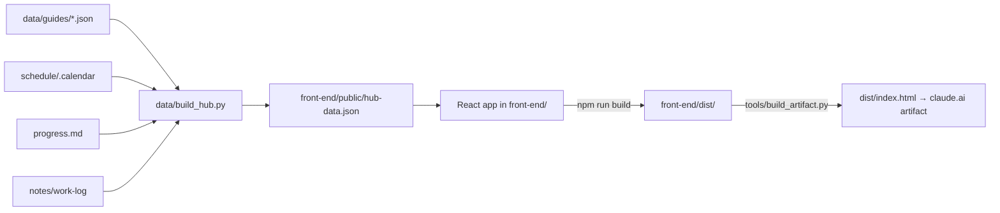

# Eagle Learning Hub

My study app for the Code Platoon bootcamp: today's class, a step-by-step guide for every lecture, spaced review, assignments and progress. Built with **React + Vite**, like the Netflix project.

> [!warning] Test copy
> This folder is a **reorganized test copy** of `hub/`, made on Oct 22, 2026. The live hub still runs from `hub/`, and `/sync` still updates `hub/`. Nothing here is published yet.

- **Live page:** https://claude.ai/artifact/MtGWwvJQRsSXyC7YqFozf9 (private; still built from `hub/`)
- **Design system:** https://claude.ai/artifact/HZUBEYey53MBnWwo1CXsiG
- **Case study:** https://claude.ai/artifact/XFRFRsucVKspAeFKQBQ6vG
- **GitHub (front end only):** https://github.com/cruzjay188/learning-hub (still the single-file version)

## Run it

```bash
cd front-end
npm install
npm run dev     # open http://localhost:5173
npm test        # run the test suite (Vitest)
npm run build   # production build → front-end/dist/
```

Outside claude.ai, progress saves to this browser. To fake the date and time for testing, run this in the browser console: `localStorage["hub:debug-now"] = "2026-10-19T11:15"`.

## Accounts (Supabase)

Students create an account (email + password) and their checkmarks, ratings, notes, statuses and weekly goal save to **Supabase project `eagle-learning-hub`** (https://supabase.com/dashboard/project/fhlxeswlqzdhkvtcbjym). Row-level security means each student can only read and change their own rows.

- **Tables:** `profiles`, `lecture_progress`, `assignment_status`, `study_days`, `student_settings`: `supabase/schema.sql` (history in `supabase/migrations/`).
- **The course itself** (lectures, guides, schedule) still ships in `hub-data.json`, not the database.
- **Keys:** `front-end/.env.local` (not committed; template in `.env.example`) holds the project URL and the *publishable* key. Without it the hub runs with no accounts and saves to this browser.
- **QA:** `npm run build:qa` builds without accounts (for `motion.mjs` and `compare.mjs`); `node qa/accounts.mjs` tests accounts end to end against the normal build.

## How it works



1. **Course data.** `data/build_hub.py` reads the lecture guides, the calendar, `progress.md`, the work logs and your git commits, and writes `front-end/public/hub-data.json`.
2. **The React app** loads that JSON (`hooks/useHubData.js`) and draws every page.
3. **Your progress** (ticks, ratings, notes, goal) lives in a small store (`lib/progressStore.js`). It saves to this browser right away, and to your claude.ai account when the page runs as the artifact (`lib/cloud.js`).
4. **Publishing:** the artifact host serves one HTML file, so `tools/build_artifact.py` puts the built JS and CSS inside `dist/index.html`.

## How it's organized

```
learning-hub/
  front-end/          the React app (run npm commands here)
    app_outline/      user_journey.md: what you can do, page by page
    public/           hub-data.json (generated by data/build_hub.py)
    src/
      main.jsx        starts React, loads the styles in order
      App.jsx         loads the data, then the page: top bar, the current view, tab bar, dialogs
      views/          one component per page: Today, Course, Lecture, Review, Work
      components/     reusable UI: Ring, Ticker, StepItem, RatingControl, FlipDeck, Timeline, TopBar…
        sheets/       the dialogs: Rate, Notes, Help, Catch up, Review
      hooks/          useHub (shared context), useHubData (fetch), useStore, useShortcuts
      lib/            actions.js (every click and key), progressStore + cloud (saving), motion + continuity (animation), route, storage
      utils/          pure helpers: dates, format, model (status, review schedule, up next), schedule, search, prompts
      styles/         11 CSS files, in cascade order (01-base.css has the design tokens)
      test/           Vitest + React Testing Library
  supabase/           schema.sql, migrations/, config.toml (the database for student accounts)
  data/               build_hub.py + guides/ (one JSON guide per lecture; spec in data/guides/README.md)
  tools/              build_artifact.py: React build → one page for the artifact
  dist/               build output for the artifact (generated)
  design-system/      tokens, components and the generators (HOW-TO-UPDATE.md)
  design/             design briefs, UX audits, old-versions/ of the page
  case-study/         portfolio case study page
  qa/                 serve.py, shoot.mjs (screenshots), motion.mjs (20 animation checks), compare.mjs (old vs new)
  docs/               database ERD, SQL schema, work-log list
  site/               the step before React: the original page split into plain css/ + js/ files (can be deleted)
```

### Where to make a change

| I want to… | Look in |
|---|---|
| Change what a page shows | `src/views/<Page>.jsx` |
| Change a piece used on several pages | `src/components/` |
| Change what a click or key does | `src/lib/actions.js`, `src/hooks/useShortcuts.js` |
| Change how status, review dates or Up next are worked out | `src/utils/model.js` (and its tests in `src/test/model.test.js`) |
| Change colors, fonts, spacing | `src/styles/01-base.css` (tokens), then the design system |
| Change a lecture guide | `data/guides/<id>.json`, then `python3 -I data/build_hub.py` |

## Checks

```bash
cd front-end && npm test && npm run build        # unit + component tests, production build
cd .. && python3 -I qa/serve.py front-end/dist &  # serve the build at http://127.0.0.1:4180
node qa/motion.mjs design/screens/motion          # 20 animation checks
```

`qa/compare.mjs` compares two builds screen by screen (page structure and pixels). It's how the React version was checked against the original: see `docs/work-logs.md`.

## Where progress is saved

In the artifact's database (owner-only read and write):
- `lectures/<lectureId>`: `{ steps: {s1: true}, notes, confidence (0–5), ratedAt, reviewedAt, touchedAt, recall: {missed: [], got: []}, updatedAt }`
- `assignments/<assignmentId>`: `{ status: todo|in-progress|check|done, done, updatedAt }`
- `meta/goal`: `{ weeklyTarget (1–7) }`, `meta/activity`: `{ days: { "YYYY-MM-DD": true } }`, `meta/onboarded`: `{ at }`

Review schedule from your rating: 1 → next class day, 2 → 2 days, 3 → 4 days, 4 → 10 days, 5 → never.
