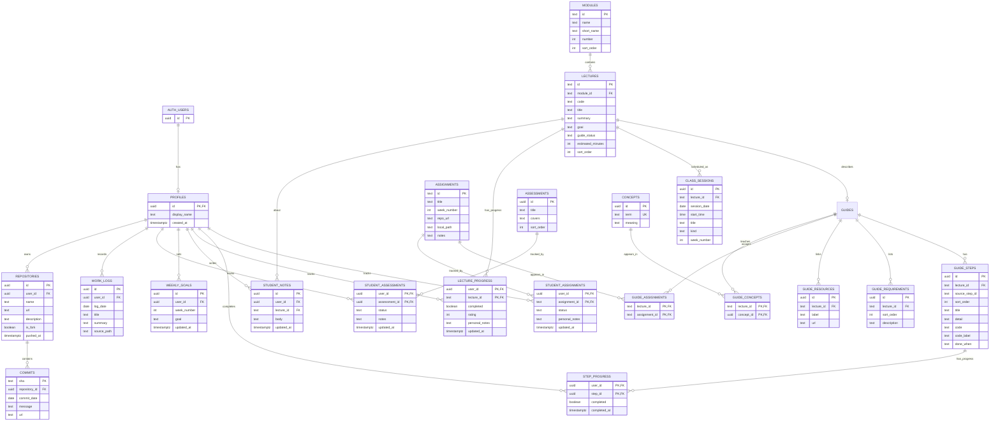

# Learning Hub data model

This ERD maps the content and student activity in `hub/hub-data.json`, `hub/guides/*.json`, `progress.md`, the calendar feed, and `notes/work-log/`. It is a normalized starting point for moving the Hub's basic content and saved progress into Supabase.

## ERD

`AUTH_USERS` is Supabase's built-in `auth.users` table; it is shown to make ownership links clear and should not be recreated. `PROFILES.id` is the authenticated user's UUID.

## What belongs in the database

| Hub data | Tables | Reason |
|---|---|---|
| Modules, lecture guides, ordered guide steps, requirements, resources, concepts | `modules`, `lectures`, `guide_steps`, `guide_requirements`, `guide_resources`, `concepts`, `guide_concepts` | Shared curriculum catalog. Seed from the JSON guide files. |
| Assignment catalog and guide links | `assignments`, `guide_assignments` | Assignments can be associated with more than one lecture, and vice versa. |
| Calendar items | `class_sessions` | One lecture can have several dated sessions. Keep non-lecture items with a null `lecture_id`. |
| Student state | `lecture_progress`, `step_progress`, `student_assignments`, `student_notes`, `weekly_goals` | User-specific and protected by Supabase RLS. |
| Work logs and GitHub activity | `work_logs`, `repositories`, `commits` | Optional syncable activity; these can be added after basic progress works. |
| Assessments | `assessments`, `student_assessments` | The current Hub has a small fixed list; keep each student's status separate from the catalog. |

## Suggested implementation order

1. Create `profiles`, `modules`, `lectures`, `guide_steps`, and the guide child tables; seed the catalog.
2. Add `lecture_progress`, `step_progress`, and `student_assignments` with RLS. This supports per-user checkmarks and ratings.
3. Add notes and weekly goals. Keep these separate from shared guide content so users cannot overwrite one another.
4. Add assessments and schedule sessions; add optional work-log/repository sync when the basic Hub reads and writes correctly.

The companion [`learning_hub_schema.sql`](learning_hub_schema.sql) implements the catalog, sessions, assignments, and student progress tables with initial RLS policies. It intentionally leaves GitHub sync and assessment tracking for a later pass.
