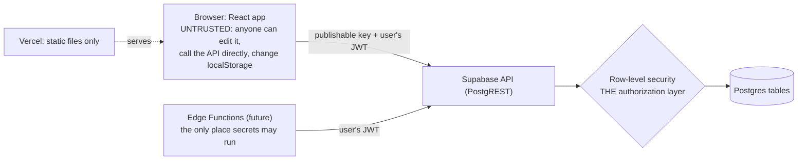

# Security rules for the Learning Hub

**Who this is for:** every AI agent (and person) that writes or changes code, SQL, config or deploys in this repo.
**Status:** mandatory. `CLAUDE.md` loads this file. If a request would break a rule here, stop and ask Jeffrey before writing anything. Never break a rule quietly "to make it work".
**Last review:** 2026-10-24 (code on `feature/auth-design`, database per `supabase/schema.sql`). Findings are in §12.

These rules target the mistakes AI coding agents make most often: data that isn't scoped to its owner, authorization that lives only in the UI, SQL built from strings, secrets in code or on the command line, and exports that leak other people's data.

---

## 0. The one thing to understand first

This app has **no server of its own**. The React app on Vercel is static files, and the browser talks **directly** to Supabase with a public (publishable) key.



So:
- **Row-level security (RLS) and database constraints are the only real security.** Anything the front end checks (hidden buttons, disabled forms, `if (user)`, a filter like `.eq('user_id', id)`) is user experience, not protection. A student can open the browser console and call the API with any filter they like.
- **The browser is untrusted.** Everything it sends (ids, `user_id`, roles, prices, row counts) can be forged.
- **Everything in the front-end bundle is public**, including every `VITE_*` variable and `hub-data.json`.

"Tenant" here means **one student** (one `auth.uid()`). If organizations or cohorts are added later, §2.6 applies.

---

## 1. Before you write or modify any code (required checklist)

Do this for every change, and put the answers in the pull request description under **Security**:

- [ ] **Data:** what data does this read or write? Whose is it (one student's, shared course content, public)?
- [ ] **Ownership:** for each table touched, which column ties a row to its owner, and which RLS policy enforces it? (§2)
- [ ] **Access:** who may do this (signed out, any student, the owner, an instructor)? Where is that enforced *on the server*? (§3)
- [ ] **Input:** what input comes from the user or from data files, and where is it validated and limited? (§4, §5)
- [ ] **Secrets:** does this need a secret? If so, it runs in an Edge Function, never in the browser. (§6)
- [ ] **Exposure:** does anything new leave the database (export, log, URL, `hub-data.json`, localStorage)? (§7)
- [ ] **Tests:** a test proves the rule, including a **second user who must be refused**. (§11)

If any answer is "I'm not sure", find out before coding.

---

## 2. Data ownership and tenant isolation

### 2.1 Every table that holds a student's data
Write all of this in the **same migration** that creates the table:

```sql
create table public.example (
  user_id    uuid not null default auth.uid() references public.profiles (id) on delete cascade,
  -- … columns, each with a size or value check (§5.1) …
  updated_at timestamptz not null default now(),
  primary key (user_id, some_id)
);
alter table public.example enable row level security;
revoke all on public.example from anon;
grant select, insert, update, delete on public.example to authenticated;   -- only what's needed
create policy "Read your own rows"   on public.example for select to authenticated using (user_id = (select auth.uid()));
create policy "Add your own rows"    on public.example for insert to authenticated with check (user_id = (select auth.uid()));
create policy "Change your own rows" on public.example for update to authenticated using (user_id = (select auth.uid())) with check (user_id = (select auth.uid()));
create policy "Delete your own rows" on public.example for delete to authenticated using (user_id = (select auth.uid()));
```

Rules:
1. **RLS on, always**, in the same migration. A table without RLS is readable and writable by anyone with the public key.
2. **`user_id` defaults to `auth.uid()`**, and the front end **never sends `user_id`**. The database fills it in, and the `with check` refuses any other value.
3. **Every policy is `to authenticated`** and compares `user_id = (select auth.uid())`. Write `(select auth.uid())`, not `auth.uid()`, so it's evaluated once per query.
4. **`update` policies have both `using` and `with check`**, so a row can't be moved to another owner.
5. **Never `using (true)`** on student data, and never a policy for `anon` on it. "Temporary open policies until auth works" are not allowed in this repo.
6. **Grant only what the feature uses.** If students never delete a row, don't grant `delete`. Restrict columns too (§3.4).
7. **Never disable RLS, never `alter … force row level security off`, never switch to the service role** to get past a permission error. A permission error means the policy or grant needs fixing; fix that, or ask.

### 2.2 Shared content (lectures, guides, catalogs)
- If it moves into the database: `select` for `authenticated` (or `anon` if it's truly public), **no** insert, update or delete grants. It changes only through migrations.
- Never mix shared content and per-student state in one row.

### 2.3 Views, functions and triggers
- **Views:** `create view … with (security_invoker = true)`, so the caller's RLS applies. A plain view runs as its owner and **bypasses RLS**.
- **Functions default to `security invoker`.** `security definer` only when unavoidable (like `handle_new_user`), and then:
  - `set search_path = ''`, with schema-qualified names inside (`public.profiles`);
  - `revoke execute … from public, anon, authenticated` unless the function is meant to be called;
  - if it is meant to be called, it checks `auth.uid()` itself and touches only that user's rows.
- RPC functions (`supabase.rpc`) follow the same rules as tables: the caller's data only.

### 2.4 Storage, Realtime and anything else
- **Storage buckets are private.** Policies key on the owner's folder: `(storage.foldername(name))[1] = (select auth.uid())::text`. Never a public bucket for student uploads.
- **Realtime** only on tables with RLS (it respects RLS; a table without it broadcasts to everyone).

### 2.5 The Management API and the CLI bypass everything
`npx supabase db query --linked` and the SQL Editor run as `postgres`: **RLS does not apply**. For agents:
- Read-only queries are fine for checking structure (policies, grants, columns).
- Changes to data only when Jeffrey asked, using **exact identifiers** (`where email in ('…', '…')`), never patterns (`like 'test%'`) that could catch a real student.
- Never read, print or change real students' rows without Jeffrey's explicit OK.
- Schema changes go through `supabase/migrations/` and `supabase/schema.sql`, never ad hoc.

### 2.6 If organizations or cohorts are added
- A `memberships (org_id, user_id, role)` table with RLS.
- A helper `public.is_member(org uuid)`: `security definer`, `stable`, `set search_path = ''`, returning whether `(select auth.uid())` belongs to `org`.
- Every org-scoped table has `org_id` and policies that call `is_member(org_id)`. **The org id is never trusted from the client**: the policy checks it.

---

## 3. Authorization and roles (RBAC)

1. **There is no middleware.** Route guards, hidden tabs, `if (auth.status === 'signedIn')` and disabled buttons are user experience. Every rule that matters is in a policy, a grant, a constraint, or an Edge Function check.
2. **Roles live on the server.** Either a `user_roles (user_id, role)` table that only migrations or the service role write, or `app_metadata.role` set from an Edge Function.
   - **Never use `user_metadata` / `raw_user_meta_data` for authorization.** Students can change it themselves with `supabase.auth.updateUser`. Today it's used only for the display name at sign-up, which is fine.
   - Never grant a role by email address or domain. Email confirmation is off, so an email address proves nothing (§8).
3. **Check roles inside policies** with a `security definer` helper, e.g. `public.has_role('instructor')`, under the rules in §2.3. Least privilege: an instructor gets `select` on what they need, not write access.
4. **Columns:** limit what can change. Example: `profiles` should allow `update (display_name)` only, not `id` or `created_at`.
5. **Edge Functions:**
   - Keep JWT verification on (the default). Only a webhook with no Supabase login (such as Stripe's) may use `--no-verify-jwt`, and it must then verify the sender's signature instead.
   - Identify the user from the token (`supabase.auth.getUser(jwt)`), **never** from a `user_id` in the body or the query string.
   - Query with a client built from the **user's JWT**, so RLS applies. Use the service-role client only when there's no alternative, and then check ownership in code before every read or write, and say so in a comment.
6. **Fail closed.** An unknown role, a missing session or an error means no access.

---

## 4. Queries and injection

1. **Front end:** supabase-js query builders only (`.from().select().eq()`).
   - **Never build PostgREST filter strings from input.** `.or(...)`, `.filter(...)`, `.not('col', 'in', `(${…})`)` and `.textSearch(...)` take raw filter syntax, so user text in them is an injection. If a value must go into one, validate it against a strict pattern first (e.g. `/^\d{4}-\d{2}-\d{2}$/` for a date), or use `.in('col', array)`.
   - Never `select('*')` on a table that has (or may gain) columns the user shouldn't see. Name the columns.
2. **SQL (migrations, RPC, triggers):** no dynamic SQL from parameters. In PL/pgSQL, use the parameters directly (they're bound). If an identifier must be dynamic, use `format('%I', …)` for identifiers and `%L` for literals, or `execute … using`. Never `||`-concatenate input into SQL.
3. **Edge Functions:** supabase-js, or parameterized queries (tagged templates), never string concatenation. Validate the body against a schema before using it.
4. **Never pass user input to `eval`, `new Function`, `setTimeout(string)`, a shell, or a template engine without escaping.**

---

## 5. Input validation and output encoding

### 5.1 Validate on the server (the database), and also in the UI
The UI checks are for friendly messages (`utils/authUtils.js`). The database is the enforcement:
- **Every `text` column** has a length check (`char_length(x) <= N`).
- **Every `jsonb` column** checks its type (`jsonb_typeof(x) = 'object'`) **and its size** (`pg_column_size(x) <= 16384`), so nobody can store megabytes.
- **Enums** use `check (x in (…))`. Numbers have ranges. Dates are `date` / `timestamptz`, not text.
- **Ids from the client** (`lecture_id`, `assignment_id`) have length checks. If the catalog moves into the database, use foreign keys.

### 5.2 Output
- **React escapes text by default; keep it that way.** No `dangerouslySetInnerHTML`, `innerHTML`, `outerHTML` or `insertAdjacentHTML` with any data. If Markdown or HTML ever has to be rendered, sanitize it with DOMPurify first and add a test with a `<script>` and an `onerror=` payload.
- **URLs from data** (`hub-data.json`: repos, resources, commits; anything a student types) go through a `safeUrl()` helper that allows only `https:` and `http:`. A `javascript:` URL in an `href` runs code.
- **Links that open a new tab:** `rel="noopener noreferrer"`. `window.open(url, '_blank', 'noopener,noreferrer')`, only with a `safeUrl` value.
- **Error messages** never echo raw server errors, stack traces or SQL. Auth errors never say which part was wrong (already true in `authErrorMessage`).

---

## 6. Secrets and configuration

1. **The browser gets only** `VITE_SUPABASE_URL` and the **publishable** key (`VITE_SUPABASE_ANON_KEY`). **Anything with a `VITE_` prefix is public**: it's baked into the bundle.
2. **Never put any of these** in front-end code, `VITE_*` variables, the repo, tests, logs, PR text or chat:
   - the Supabase secret / `service_role` key, or the database password;
   - Stripe `sk_` keys or webhook secrets;
   - OAuth client secrets;
   - Vercel, GitHub or Supabase access tokens;
   - any `.env.local` content.
3. **Where secrets live:**
   - `front-end/.env.local` (git-ignored) for the publishable key only;
   - Vercel env vars for the same;
   - `npx supabase secrets set` for Edge Functions;
   - the macOS Keychain for the database password.
4. **Never put a secret on a command line**: npm prints the commands it runs (that's how the database password leaked on Oct 22). Pipe values from a file or stdin, and don't print them.
5. **No hardcoded passwords or keys in code, even "for testing".** Test accounts generate a password at run time (`qa/accounts.mjs`).
6. **Before every commit:** `git status`, then the scan in §11. `.env*` (except `.env.example`, `.env.qa`), `.mcp.json`, `.vercel/` and `.temp/` must stay ignored.
7. **If a secret leaks:** rotate it first (Supabase dashboard / Vercel / GitHub), then remove it from the code and history, then tell Jeffrey.
8. **Deploying from a laptop** (`vercel deploy`) relies on `.vercelignore` to keep `.env.local` files out. Check the uploaded file list if that file changes.

---

## 7. Data leaving the database: exports, the public bundle, the browser

### 7.1 Client-side exports (CSV / JSON downloads), if added
- **Only the logged-in student's own data**, fetched fresh through RLS at click time. Never from a shared or cached object, and never "all rows then filter in JavaScript".
- **CSV formula injection:** prefix any cell that starts with `=`, `+`, `-`, `@`, a tab or a carriage return with `'`, and quote every cell.
- Build the file with a `Blob` and `URL.createObjectURL`, then `revokeObjectURL` after the download. Never upload an export to a public URL or storage bucket.
- No export of other students' data, unless a role and a policy allow it (§3) and Jeffrey approved it.

### 7.2 The public bundle and `hub-data.json`
- Everything in `front-end/public/` and the build is public on the internet.
- **No personal data in `hub-data.json`**: no one student's assignment notes, commit messages, emails or work logs. Per-student data goes in Supabase behind RLS.

### 7.3 localStorage and sessionStorage
- **Treat them as tamperable and readable by any script on the page.** Never store secrets or other users' data there.
- Progress copies use the per-student key (`eagle-hub:v1:<user id>`) and are removed on logout (`lib/auth.js`, `forgetLocalData`). Keep that for any new cached data.
- Values read back from storage are validated before use, especially if they end up in a query (§4.1).

### 7.4 Logs
- Nothing in `console.*` with tokens, emails, notes or other personal data. Errors log a code, not the payload.

---

## 8. Authentication and sessions

- **Supabase Auth only.** No custom password handling or hashing, and no auth state of our own beyond what supabase-js manages.
- **Known trade-off for the class:** email confirmation is off, so anyone can sign up with any address. Therefore an email address proves nothing: never use it for roles, sharing or trust.
- **Passwords:** minimum 6 today (Supabase default). Recommended: 8+ and Supabase's leaked-password protection.
- **Redirect URLs** (Auth → URL Configuration): allowlist exact origins only (the Vercel URL, `http://localhost:5173`). No wildcards for production.
- **Logging out** clears this browser's copy of the student's data first, then ends the session, including offline (`scope: 'local'`). Keep it that way.
- **Password reset**, when built, uses Supabase's `resetPasswordForEmail` with an allowlisted `redirectTo`, and never says whether an email has an account.

---

## 9. Dependencies and the supply chain

- **Add a package only when the feature needs it.** Prefer what's already installed.
- **Pin security-relevant packages exactly** (`@supabase/supabase-js` is pinned at `2.117.0`), and keep `package-lock.json` committed. Use `npm ci` in builds.
- **Run `npm audit`** when adding or upgrading packages, and fix high or critical issues before merging.
- **No scripts from CDNs** without an exact version. No `postinstall` scripts from new packages without reading them.

---

## 10. Hosting and HTTP headers (Vercel)

- Add security headers in `front-end/vercel.json`:
  - `Content-Security-Policy` with `default-src 'self'`; `connect-src` for the Supabase URL; `style-src` and `font-src` for Google Fonts; `frame-ancestors 'none'`;
  - `X-Content-Type-Options: nosniff`;
  - `Referrer-Policy: strict-origin-when-cross-origin`;
  - `Permissions-Policy` turning off what isn't used.
- Preview deployments use the same Supabase project, so they're as real as production: same rules.

---

## 11. How to prove it (run before calling a change done)

```bash
# 1. unit + component tests, build
cd front-end && npm test && npm run build && cd ..

# 2. cross-user isolation in a real browser, against Supabase (student B must see none of A's data)
python3 -I qa/serve.py front-end/dist &  node qa/accounts.mjs
#    then delete exactly the two printed accounts (CLAUDE.md, "Test accounts")

# 3. every public table has RLS and policies (read-only check)
npx supabase db query --project-ref fhlxeswlqzdhkvtcbjym --linked \
  "select c.relname, c.relrowsecurity, count(p.*) from pg_class c join pg_namespace n on n.oid = c.relnamespace left join pg_policies p on p.tablename = c.relname and p.schemaname = 'public' where n.nspname = 'public' and c.relkind = 'r' group by 1, 2"

# 4. a visitor who isn't logged in gets refused (expect 401 / permission denied, never rows)
set -a; . front-end/.env.local; set +a   # loads the URL and the publishable key, without printing them
curl -s -H "apikey: $VITE_SUPABASE_ANON_KEY" "$VITE_SUPABASE_URL/rest/v1/lecture_progress?select=*"

# 5. no secrets staged
git diff --cached -U0 | grep -E '^\+' | grep -nE 'sb_secret_|service_role|eyJhbGciOi|sk_live_|sk_test_[A-Za-z0-9]{10}|ghp_|VERCEL_OIDC|password\s*=' || echo "no secrets found"
```

**Every new table or policy gets a test that a second user is refused**: extend `qa/accounts.mjs`, or add a SQL check. "It works for me" is not a test of isolation.

---

## 12. Findings from the 2026-10-24 review

What's already right:
- RLS is on for all five tables, with owner-only policies `to authenticated`, and `anon` is revoked. A visitor's read and write were refused when tested on Oct 22.
- `update` policies have both `using` and `with check`.
- `handle_new_user` is `security definer` with `search_path = ''` and execute revoked.
- Text columns have length checks and `status` is an enum check.
- Only the publishable key is in the bundle, and `.env.local` is ignored.
- Auth errors don't reveal which part was wrong.
- Logout clears local data, even offline.
- React rendering, with no raw-HTML sinks.

To fix (not done yet: each needs its own feature branch and migration):

| # | Severity | Finding | Where | Fix |
|---|---|---|---|---|
| 1 | Medium | `hub-data.json` is public on Vercel and contains Jeffrey's assignment notes, commit messages and work-log titles. Every student who signs up sees them. | `data/build_hub.py` → `front-end/public/hub-data.json` | Split shared course content from personal data; move per-student data into Supabase (§7.2) |
| 2 | Medium | No security headers (CSP, nosniff, frame-ancestors) on the Vercel site. | missing `front-end/vercel.json` | Add headers (§10) |
| 3 | Low | The client sends `user_id` on every write, and `user_id` has no `default auth.uid()`. RLS refuses forged values, so it isn't exploitable, but it breaks rule 2.1.2 and the instructors' convention. | `lib/supabaseSync.js`, the migration | `alter … set default auth.uid()`, then stop sending `user_id` |
| 4 | Low | `jsonb` columns (`steps`, `recall`) have no size limit, so a student could store very large values (storage abuse). | `lecture_progress` | Add `check (pg_column_size(steps) <= 16384)` and the same for `recall` (§5.1) |
| 5 | Low | `profiles` grants `update` on all columns; only `display_name` should change. | `supabase/schema.sql` | `revoke update on profiles from authenticated; grant update (display_name) …` |
| 6 | Low | A PostgREST filter is built from a string: `.not('day', 'in', `(${days.join(',')})`)`. The values come from the student's own (tamperable) local copy. RLS limits the damage to their own rows, but it breaks §4.1. | `lib/supabaseSync.js` | Validate each day with `/^\d{4}-\d{2}-\d{2}$/` before building the filter |
| 7 | Low | URLs from `hub-data.json` go straight into `href` and `window.open` without a scheme check. The data is built from the repo (trusted today), but guides are edited by hand. | `views/*.jsx`, `lib/actions.js` | Add `safeUrl()` (§5.2) and use it everywhere a URL comes from data |
| 8 | Info | Email confirmation is off and the password minimum is 6. | Supabase Auth | Fine for class; never trust email (§8). Consider 8+ and leaked-password protection |
| 9 | Info | The live database wasn't checked against `schema.sql` in this review (the CLI's login had expired). | — | Run §11 step 3 after `npx supabase login` |
